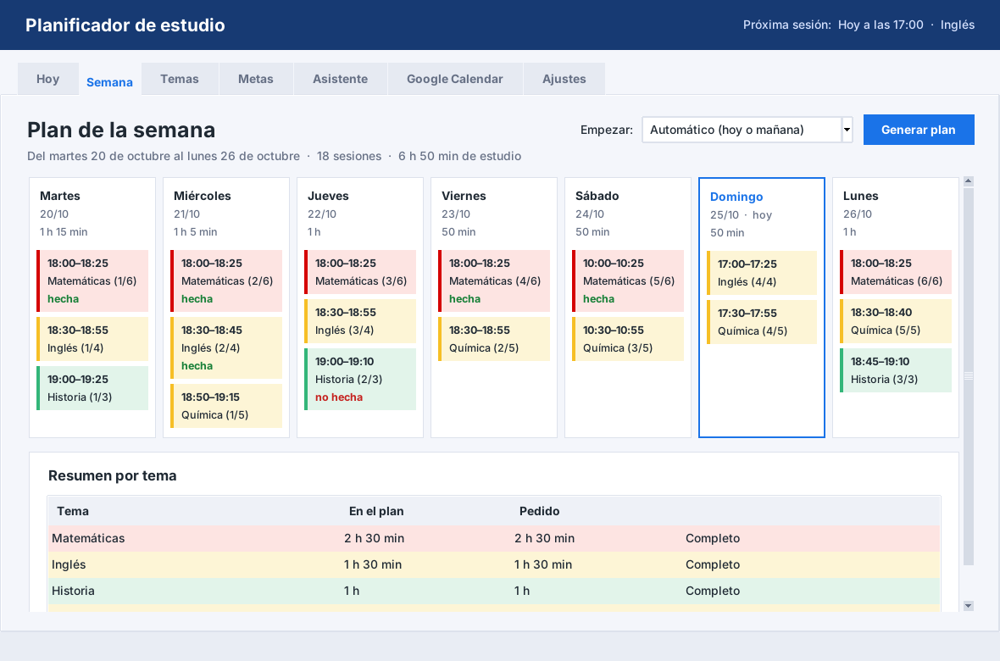
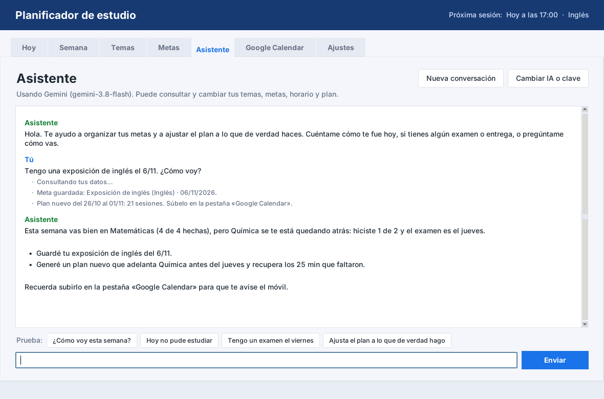

# study-planner
“Study planner that splits your time into short sessions and syncs them with Google Calendar.”

# Planificador de estudio

Reparte tu tiempo de estudio entre temas en **sesiones cortas** (por defecto de 25 minutos) y las crea en **Google Calendar**, para que el **teléfono te avise** antes de cada una. No hace falta programar nada para el móvil: basta con la app de Google Calendar.

> **¿Es tu primera vez?** Sigue la [guía de inicio](GUIA_DE_INICIO.md): explica paso a paso cómo instalarlo y cómo conseguir lo que pide (Python, las librerías, el permiso de Google y, si quieres el asistente, la clave de la IA).

Qué hace:

- Guarda temas con su **prioridad** (1 a 5) y los **minutos por semana** que quieres dedicarles.
- Genera las **sesiones cortas de cada día** para los próximos 7 días, con descansos entre medias.
- Crea esas sesiones en **Google Calendar** (API gratuita) con un aviso tipo notificación.
- **Se adapta a lo que haces:** marcas cada sesión como hecha o no hecha, y el plan siguiente recupera lo que faltó. Tus **metas con fecha** (un examen, una entrega) hacen que ese tema suba de prioridad y se estudie antes.
- Tiene un **asistente con inteligencia artificial** (Claude o Gemini, a elegir) al que le hablas normal: "el viernes tengo examen de química", "hoy no pude estudiar"… y él ajusta temas, metas y plan.
- Tiene una **ventana con botones**, para usarlo sin escribir comandos.



---

## 1. Requisitos

- **Python 3.10 o más nuevo.** Para comprobarlo, abre PowerShell y escribe `python --version`.
- Una **cuenta de Google** (vale una de Gmail normal).
- En el teléfono, la app **Google Calendar** con esa misma cuenta (solo para recibir los avisos).

## 2. Instalación

1. Abre la carpeta del programa en el Explorador de archivos.
2. Haz clic derecho en un espacio vacío y elige **Abrir en Terminal** (o abre PowerShell y ve a la carpeta con `cd`).
3. Instala las librerías (las de Google Calendar y las del asistente):

```bash
python -m pip install -r requirements.txt
```

> Sin estas librerías la app funciona igual para guardar temas, generar el plan y marcar lo que haces. Las de Google solo hacen falta para `subir` y `limpiar`, y las de Claude y Gemini solo para el asistente.

## 3. Uso rápido

### Con la ventana (lo más fácil)

Haz **doble clic en `Abrir planificador.bat`** (o, en la terminal, escribe `python interfaz.py`). La ventana tiene siete pestañas:

| Pestaña | Para qué sirve |
|---|---|
| **Hoy** | Las sesiones de hoy, con la que toca ahora resaltada, y los botones **Hecha** / **No la hice** para marcarlas. Debajo, las de días anteriores que quedaron sin marcar. |
| **Semana** | Botón **Generar plan** y el plan de 7 días, día por día, con colores según la prioridad y lo ya hecho. Arriba explica cómo se adaptó el plan; debajo, cuánto tiempo recibe cada tema. |
| **Temas** | Agregar, cambiar o quitar temas (haz clic en un tema para cambiarlo). |
| **Metas** | Tus metas (con tema y fecha, si quieres) y tu progreso de los últimos 14 días: sesiones hechas, no hechas, racha y lo pendiente de recuperar. |
| **Asistente** | Chat con Claude o Gemini, que puede consultar y cambiar tus temas, metas, horario y plan (ver sección 10). |
| **Google Calendar** | Te dice qué falta para conectar, sube el plan al calendario o borra sus sesiones. |
| **Ajustes** | Cambia `config.json` con casillas: duración de las sesiones, descansos, días y horas, aviso en el teléfono y si recuperar lo no hecho. |

La ventana y los comandos usan los mismos datos, así que puedes usar lo que prefieras en cada momento.

### Con comandos

```bash
python planificador.py agregar "Matemáticas" --prioridad 5 --minutos 150
```

```bash
python planificador.py agregar "Inglés" --prioridad 3 --minutos 90
```

```bash
python planificador.py generar
```

```bash
python planificador.py subir
```

Y cada día, para ver lo que te toca:

```bash
python planificador.py hoy
```

Ejemplo de lo que muestra `generar` con cuatro temas (Matemáticas 150 min, Química 110, Inglés 90 e Historia 60):

```
Plan de estudio del 26/10/2026 al 01/11/2026

Lunes 26/10
  18:00-18:25  Matemáticas (1/6)
  18:30-18:55  Química (1/5)
  19:00-19:25  Inglés (1/4)
  19:30-19:40  Historia (1/3)
  = 85 min de estudio

Martes 27/10
  18:00-18:25  Matemáticas (2/6)
  ...
Domingo 01/11  (libre)

Resumen por tema:
  Matemáticas: 150 de 150 min
  Química: 110 de 110 min
  ...
```

El `(2/6)` quiere decir "sesión 2 de las 6 que tiene ese tema esta semana".

## 4. Todos los comandos

| Comando | Qué hace |
|---|---|
| `agregar "Tema" -p 4 -m 120` | Agrega un tema con prioridad 4 y 120 min por semana. Si ya existe, lo actualiza. La prioridad es opcional (por defecto 3). |
| `temas` | Muestra los temas guardados y el total de minutos por semana. |
| `quitar "Tema"` | Quita un tema. No importan las mayúsculas ni las tildes. |
| `generar` | Crea el plan de los próximos 7 días y lo guarda. Empieza hoy, o mañana si tu hora de inicio de hoy ya pasó. |
| `generar --desde 2026-11-02` | Igual, pero empezando en esa fecha (formato AAAA-MM-DD). |
| `hoy` | Muestra las sesiones de hoy según el último plan generado. |
| `hoy --fecha 2026-11-04` | Muestra las sesiones de otro día. |
| `subir` | Crea las sesiones del plan en Google Calendar, cada una con su aviso. |
| `subir --simular` | Muestra lo que se crearía, **sin** conectarse a Google. Útil para probar. |
| `subir --reemplazar` | Si ya habías subido sesiones en esas fechas, las borra y sube las nuevas (por ejemplo, después de cambiar un tema). |
| `limpiar` | Borra del calendario las sesiones que creó esta app en las fechas del plan. **Nunca toca tus otros eventos.** |
| `limpiar --desde 2026-10-26 --hasta 2026-11-01` | Igual, para las fechas indicadas. |
| `config` | Muestra la configuración actual y dónde está el archivo. |
| `marcar hecha "Tema"` | Marca como hecha la sesión de ese tema de hoy (si hay varias, la primera sin marcar). |
| `marcar no "Tema" --fecha 2026-10-26` | Marca como **no** hecha la de ese día. Con `--hora 18:30`, una en concreto; con `quitar`, le quita la marca. |
| `progreso` | Lo hecho en los últimos 14 días por tema, tu racha y lo pendiente de recuperar. |
| `progreso --olvidar "Tema"` | Deja de recuperar lo pendiente de ese tema. |
| `meta "Examen de Química" --tema Química --fecha 2026-11-13` | Guarda una meta. Tema y fecha son opcionales; con los dos, el plan se adapta a ella. |
| `metas` | Muestra tus metas con su número. |
| `meta-cumplida 1` | Marca la meta 1 como cumplida (`--deshacer` la deja pendiente otra vez). |
| `quitar-meta 1` | Quita la meta 1. |
| `clave gemini` (o `clave claude`) | Guarda tu clave del asistente (te la pide sin que se vea) y lo deja elegido. `--borrar` la borra. |
| `asistente` | Conversación con el asistente en la terminal. Escribe `salir` para terminar. |

Todos se escriben después de `python planificador.py`. Para ver la ayuda de un comando: `python planificador.py subir -h`.

**Flujo semanal recomendado:** el domingo (o el primer día de tu semana) ejecuta `generar` y luego `subir`. Cada día, marca tus sesiones (`marcar hecha …` o `marcar no …`). Si cambias algo a mitad de semana, vuelve a ejecutar `generar` y `subir --reemplazar`.

## 5. Conectar con Google Calendar (solo una vez)

> Estos mismos pasos, más detallados y con una lista de comprobación, están en la [guía de inicio](GUIA_DE_INICIO.md).

La API de Google Calendar es gratuita y no pide tarjeta. Necesitas crear un "proyecto" en Google Cloud y descargar un archivo de permisos llamado `credentials.json`. Se hace una sola vez y lleva unos 10 minutos.

### 5.1 Crear el proyecto y activar la API

1. Entra a <https://console.cloud.google.com/> con tu cuenta de Google.
2. Arriba, junto al logo, abre el selector de proyectos y pulsa **New project** (Proyecto nuevo). Ponle un nombre, por ejemplo `planificador-estudio`, y créalo.
3. Con ese proyecto seleccionado, ve a <https://console.cloud.google.com/apis/library/calendar-json.googleapis.com> y pulsa **Enable** (Habilitar).

### 5.2 Configurar la pantalla de permiso

1. En el menú ☰, ve a **Google Auth platform → Branding**. Si aparece "Google Auth platform not configured yet", pulsa **Get started**.
2. **App information:** escribe un nombre (por ejemplo `Planificador de estudio`) y elige tu correo como *User support email*. Pulsa **Next**.
3. **Audience:** elige **External** (con una cuenta de Gmail normal es la única opción). Pulsa **Next**.
4. **Contact information:** escribe tu correo. Pulsa **Next**.
5. **Finish:** acepta la política de datos y pulsa **Continue** y luego **Create**.
6. Ve a **Google Auth platform → Audience**, busca **Test users**, pulsa **Add users** y añade **tu propio correo**. Guarda.

> La app queda en modo *Testing* (prueba): solo pueden usarla los correos que pongas como test users. Para uso personal es justo lo que queremos.

### 5.3 Crear y descargar `credentials.json`

1. Ve a **Google Auth platform → Clients** y pulsa **Create client**.
2. En **Application type** elige **Desktop app**. Ponle un nombre cualquiera y pulsa **Create**.
3. En la ventana que aparece, pulsa **Download JSON**. Hazlo en ese momento: puede que Google no te deje descargarlo después. Si lo pierdes, crea otro cliente.
4. Mueve el archivo descargado a la carpeta del programa y **renómbralo a `credentials.json`** (junto a `planificador.py`).

### 5.4 Primer inicio de sesión

Ejecuta `python planificador.py subir`. Se abrirá el navegador:

1. Elige tu cuenta.
2. Verás un aviso **"Google no ha verificado esta app"**. Es normal: la app es tuya y no está publicada. Pulsa **Continuar**.
3. Acepta el permiso para **ver y editar eventos** de tus calendarios.
4. Cuando el navegador diga "Listo. Ya puedes cerrar esta pestaña", vuelve a la terminal.

La app guarda el permiso en `token.json`, así que las siguientes veces no se abre el navegador.

> **Importante:** en modo *Testing*, Google hace caducar el permiso cada **7 días**. Cuando pase, la app abrirá el navegador otra vez al usar `subir` o `limpiar`; solo tienes que volver a aceptar. Si te molesta, en **Google Auth platform → Audience** puedes pulsar **Publish app**; seguirá apareciendo el aviso de "app no verificada", pero el permiso dura más.

> **Privacidad:** `credentials.json` y `token.json` dan acceso a tu calendario. No los compartas ni los subas a internet.

## 6. Recibir los avisos en el teléfono

1. Instala **Google Calendar** en el teléfono (Android o iPhone) e inicia sesión con la **misma cuenta**.
2. Activa sus notificaciones: en el teléfono, *Ajustes → Notificaciones → Google Calendar → permitir*. Dentro de la app, en *Configuración → (tu cuenta)*, comprueba que las notificaciones de eventos estén activadas.
3. Listo: cada sesión creada con `subir` te avisará los minutos antes que diga `aviso_minutos_antes` (por defecto, 5).

Las sesiones aparecen con el título `Estudiar: Tema (2/6)` y con un color según la prioridad: rojo (5), naranja (4), amarillo (3), verde (2) y gris (1).

## 7. Configuración (`config.json`)

Puedes cambiar estos valores con el Bloc de notas. Respeta las comillas y las comas. Si te equivocas, la app te dirá qué línea revisar. Si borras el archivo, se vuelve a crear con los valores de abajo.

| Clave | Por defecto | Qué significa |
|---|---|---|
| `duracion_sesion` | `25` | Minutos de cada sesión corta. |
| `duracion_minima` | `10` | Si al partir un tema sobran menos minutos que esto, se suman a la última sesión en vez de crear una minúscula. |
| `descanso_corto` | `5` | Minutos de descanso entre sesiones. |
| `descanso_largo` | `15` | Minutos del descanso largo. |
| `sesiones_antes_de_descanso_largo` | `4` | Cada cuántas sesiones toca el descanso largo (`0` = nunca). |
| `maximo_minutos_por_dia` | `120` | Máximo de estudio por día, sin contar descansos (`0` = sin límite). |
| `horario` | lunes a viernes `18:00`, sábado `10:00` | Días en que estudias y a qué hora empiezas cada uno. Quita un día para no estudiar ese día. Ejemplo: `{"lunes": "17:30", "domingo": "11:00"}`. Las sesiones de un día terminan como muy tarde a medianoche, así que si empiezas tarde caben menos. |
| `aviso_minutos_antes` | `5` | Minutos antes de cada sesión en que suena el aviso (`0` = justo al empezar). |
| `id_calendario` | `"primary"` | Calendario de Google donde se crean las sesiones. `primary` es el principal. |
| `recuperar_no_hechas` | `true` | Si es `true`, lo que marcas como no hecho se añade al plan siguiente para recuperarlo (`false` = no). |
| `asistente` | `"claude"` | IA del asistente: `"claude"` o `"gemini"`. Se cambia sola al poner una clave en la pestaña Asistente. |
| `modelo_claude` | `"claude-opus-5-5"` | Modelo de Claude que usa el asistente. |
| `modelo_gemini` | `"gemini-3.8-flash"` | Modelo de Gemini que usa el asistente. |

**Consejo: un calendario aparte para estudiar.** En Google Calendar (web), crea un calendario nuevo llamado "Estudio" (*Otros calendarios → + → Crear calendario*). Luego, en su *Configuración → Integrar el calendario*, copia el **ID del calendario** (algo como `abc123@group.calendar.google.com`) y pégalo en `id_calendario`. Así puedes ocultar o mostrar todas tus sesiones de un clic.

## 8. Cómo reparte el tiempo

1. **Parte cada tema en sesiones cortas.** Con sesiones de 25 min: 100 min → 4 sesiones de 25; 110 min → 4 de 25 y una de 10; 105 min → 3 de 25 y una de 30.
2. **Reparte las sesiones entre los días de estudio:**
   - Empieza por los temas de **mayor prioridad**. Si no cabe todo en la semana, se quedan fuera primero los de **menor prioridad**, y `generar` te avisa de cuántos minutos faltaron.
   - Un mismo tema va a **días distintos** y, si se puede, **no seguidos** (por ejemplo lunes, miércoles y viernes). Estudiar con espacio entre repasos ayuda a recordar.
   - Intenta que cada día tenga una **carga parecida**, sin pasar del máximo diario y terminando antes de medianoche.
3. **Ordena cada día:** primero lo más prioritario (cuando estás más fresco) y sin repetir el mismo tema dos veces seguidas si hay alternativa.
4. **Pone las horas:** desde tu hora de inicio, con descanso corto entre sesiones y uno largo cada 4.

## 9. Cómo se adapta el plan a lo que haces

Cada vez que generas un plan, mira lo que has marcado y tus metas, y lo explica arriba del plan («Cómo se adaptó este plan»):

- **Recupera lo que no hiciste.** Las sesiones marcadas como *no hechas* en los últimos 14 días se añaden al plan nuevo como sesiones de **recuperación** (en Google Calendar llevan «· recuperación» en el título). Se colocan **después** de lo normal, solo si queda sitio, y nunca más de los minutos semanales del tema. Cuando haces una recuperación, deja de contar como pendiente. Si ya no quieres recuperar un tema, usa «Olvidar lo pendiente» (pestaña Metas) o `progreso --olvidar`.
- **Prepara tus metas.** Una meta con **tema y fecha** (por ejemplo, un examen) hace que ese tema:
  - suba a prioridad **5** si la fecha cae en los próximos 7 días, o **un punto más** si cae en los próximos 14;
  - coloque sus sesiones **antes de esa fecha** cuando la fecha cae dentro del plan.
- **Lo que no marcas no cuenta.** Las sesiones sin marcar no se recuperan ni cuentan como hechas: por eso la pestaña Hoy te recuerda las de días anteriores que quedaron sin marcar.

## 10. El asistente (Claude o Gemini)

Es un chat dentro del planificador (pestaña **Asistente**, o `python planificador.py asistente`). Le hablas normal y él consulta tus datos y los cambia cuando hace falta: agrega o cambia temas, guarda metas, marca sesiones, cambia tu horario o el máximo diario, genera el plan y apunta notas para recordar cómo estudias. Te pide confirmación antes de quitar temas o metas, y te recuerda subir el plan a Google Calendar (eso lo haces tú).



Ejemplos de lo que le puedes decir:

- «¿Cómo voy esta semana?»
- «Hoy no pude estudiar química.»
- «El 13 de noviembre tengo examen de inglés.»
- «Los martes ya no puedo estudiar, y los sábados mejor a las 11.»
- «No llego a todo: ajusta el plan a lo que de verdad hago.»

**Qué IA usar.** Hace falta una clave de una de estas dos (la guía de inicio, paso 7, explica cómo conseguirla):

| | Gemini (Google) | Claude (Anthropic) |
|---|---|---|
| Precio | Tiene un **nivel gratuito** con límites de mensajes por minuto y por día. | **De pago** según el uso: compras saldo por adelantado (desde unos 5 USD) y cada mensaje cuesta unos céntimos con el modelo por defecto. |
| Dónde se saca la clave | <https://aistudio.google.com/apikey> | <https://platform.claude.com> → *Settings → API keys* |
| Modelo por defecto | `gemini-3.8-flash` | `claude-opus-5-5` |

**Privacidad.** Lo que escribes en el chat y tus datos de estudio (temas, plan, progreso, metas y notas) se envían a la IA elegida para que pueda responder. En el nivel gratuito de Gemini, Google puede usar esos datos para mejorar sus productos. La clave se guarda solo en tu ordenador, en `datos/claves.json` (que nunca se sube a internet); también puedes ponerla en las variables de entorno `GEMINI_API_KEY` o `ANTHROPIC_API_KEY`.

**Detalles técnicos.** Con Claude se usa el SDK oficial `anthropic`, esfuerzo `medium`, caché de las instrucciones y el respaldo automático del servidor (`fallbacks: "default"`), que repite la petición en otro modelo si el elegido la rechaza por precaución. Con Gemini se usa el SDK oficial `google-genai` con razonamiento bajo. Las herramientas que puede usar la IA están en `asistente.py`.

## 11. Archivos de la carpeta

| Archivo | Para qué sirve |
|---|---|
| `GUIA_DE_INICIO.md` | Guía paso a paso para instalarlo y conectarlo con Google la primera vez. |
| `Abrir planificador.bat` | Abre la ventana con doble clic (Windows). |
| `interfaz.py` | La ventana con botones. |
| `planificador.py` | El programa de comandos: lee lo que escribes en la terminal y muestra los resultados. |
| `repartidor.py` | El "motor": parte los temas en sesiones y las reparte por días. |
| `calendario_google.py` | La conexión con Google Calendar (iniciar sesión, crear y borrar eventos). |
| `almacen.py` | Guarda y lee los temas, la configuración, el plan, lo marcado, las metas y las claves. |
| `progreso.py` | Lo hecho y lo no hecho, las metas, el progreso y cómo se adapta el plan. |
| `asistente.py` | El asistente con IA: sus herramientas y la conversación con Claude o Gemini. |
| `config.json` | Tus ajustes (ver sección 7). |
| `requirements.txt` | Lista de librerías que hay que instalar (Google Calendar, Claude y Gemini). |
| `tests/` | Pruebas automáticas. |
| `docs/` | Imágenes para este README. |
| `datos/temas.json` | Tus temas (se crea al agregar el primero). |
| `datos/plan.json` | El último plan generado. |
| `datos/registro.json` | Qué sesiones hiciste y cuáles no. |
| `datos/metas.json` | Tus metas. |
| `datos/memoria.json` | Notas que guarda el asistente para recordar cómo estudias. |
| `datos/claves.json` | Tu clave del asistente. **Privado.** |
| `credentials.json` | Lo descargas de Google (sección 5). **Privado.** |
| `token.json` | Lo crea la app tras iniciar sesión. **Privado.** Bórralo para cerrar sesión. |

El código está comentado línea por línea, por si quieres entender o cambiar cómo funciona.

## 12. Problemas frecuentes

| Mensaje o problema | Solución |
|---|---|
| `Faltan las librerías de Google` | Ejecuta `python -m pip install -r requirements.txt`. |
| `No encuentro credentials.json` | Sigue la sección 5.3 y comprueba que el archivo se llama exactamente `credentials.json` (Windows a veces oculta la extensión y queda `credentials.json.json`). Si el mensaje dice "Pero encontré…", renombra el archivo que indica. |
| En el navegador: **"Acceso bloqueado"** o **error 403: access_denied** | No añadiste tu correo como *test user* (sección 5.2, paso 6). |
| `Google Calendar respondió con un error (403)` y habla de la API | La API no está habilitada en tu proyecto (sección 5.1, paso 3). |
| `Ya hay N sesiones del planificador en tu calendario...` | Ya habías subido sesiones en esas fechas. Usa `subir --reemplazar` para cambiarlas por las nuevas. |
| El navegador se abre otra vez para pedir permiso | Pasa cada 7 días en modo *Testing* (ver sección 5.4). Acepta otra vez. |
| Quiero usar otra cuenta de Google | Borra `token.json` y vuelve a ejecutar `subir`. |
| No me llegan los avisos al teléfono | Revisa la sección 6: misma cuenta en el teléfono, notificaciones de la app activadas y, si usas un calendario aparte, que esté marcado como visible en la app. |
| `no entraron N sesiones` al generar | Pides más minutos de los que caben. Sube `maximo_minutos_por_dia`, agrega días en `horario`, empieza más temprano (si estudias de noche) o baja minutos de algún tema. |
| `datos/temas.json está mal escrito` o `el plan guardado está dañado` | Alguien editó esos archivos a mano. Corrige el tema que indica el mensaje, o borra `datos/temas.json` y vuelve a agregar tus temas. Para el plan, basta con ejecutar `generar` otra vez. |
| `Falta la librería de Claude` o `de Gemini` | Ejecuta `python -m pip install -r requirements.txt`. |
| `Falta la clave de …` o `La clave de … no es válida` | Pon (o vuelve a pegar) la clave en la pestaña **Asistente** → **Cambiar IA o clave**, o con `python planificador.py clave gemini`. Ver la guía de inicio, paso 7. |
| `Tu cuenta de Claude no tiene saldo` | Compra saldo en platform.claude.com (*Settings → Billing*), o cambia a Gemini. |
| `Se acabó el límite gratuito de Gemini` | Has enviado muchos mensajes seguidos. Espera un rato (o hasta el día siguiente) y vuelve a intentarlo. |
| `… no reconoce el modelo` | El modelo de `config.json` (`modelo_claude` o `modelo_gemini`) ya no existe o está mal escrito. Pon el de la tabla de la sección 7. |
| Las tildes se ven como `�` | Pasa si rediriges la salida a otro programa. En una ventana normal de PowerShell o Terminal se ven bien. |

## 13. Pruebas automáticas

Para comprobar que todo funciona (no se conecta a Google ni a la IA; usa respuestas simuladas):

```bash
python -m unittest discover -s tests -v
```

Si las librerías de Google, Claude o Gemini no están instaladas, sus pruebas se saltan y el resto se ejecuta igual. Lo mismo con las pruebas de la ventana si tu Python no tiene tkinter o no hay pantalla (por ejemplo, en un servidor).

## 14. Fuera de esta versión

- Conectar con el calendario interno de Windows.
- App propia para el móvil.

## Licencia

MIT. Ver el archivo [LICENSE](LICENSE).
