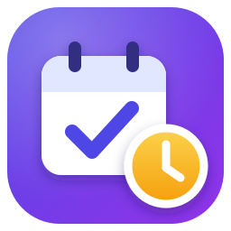
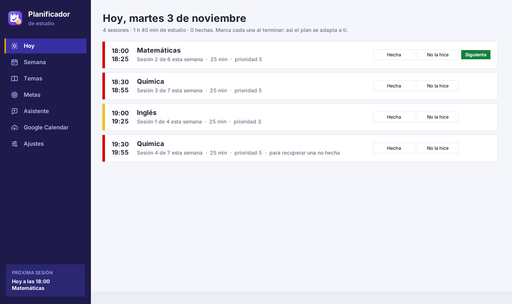
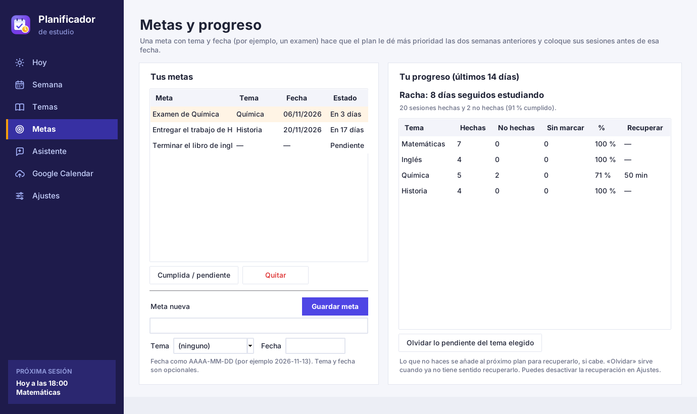
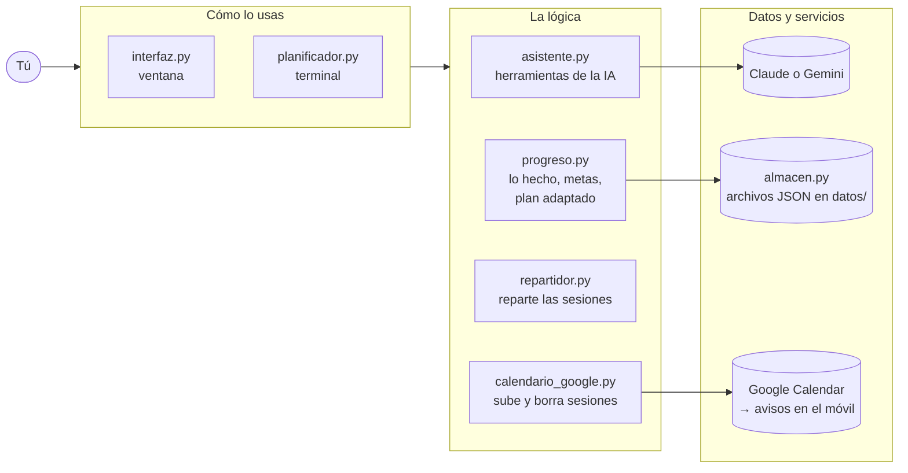
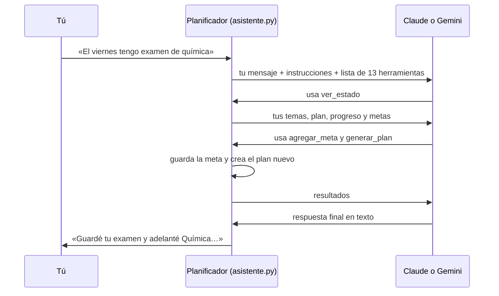

<p align="center">
  
</p>

<h1 align="center">Planificador de estudio</h1>

<p align="center">
  Reparte tu tiempo de estudio en <b>sesiones cortas</b>, las sube a <b>Google Calendar</b> para que el móvil te avise
  y <b>se adapta a lo que de verdad haces</b>. Incluye un asistente con IA (Claude o Gemini).<br>
  <sub><i>A study planner that splits your time into short sessions, syncs them with Google Calendar and adapts to what you actually do.</i></sub>
</p>

<p align="center">
  
  
  
  
</p>

<p align="center">
  
</p>

---

## Índice

1. [Un proyecto para aprender](#un-proyecto-para-aprender)
2. [Qué hace](#qué-hace)
3. [Cómo se ejecuta](#cómo-se-ejecuta)
4. [Cómo funciona](#cómo-funciona)
5. [Comandos de la terminal](#comandos-de-la-terminal)
6. [Configuración](#configuración)
7. [Seguridad y privacidad](#seguridad-y-privacidad)
8. [Pruebas automáticas](#pruebas-automáticas)
9. [Estructura del proyecto](#estructura-del-proyecto)
10. [Problemas frecuentes](#problemas-frecuentes)
11. [Lo que no hace (limitaciones)](#lo-que-no-hace-limitaciones)
12. [Licencia](#licencia)

---

## Un proyecto para aprender

Este proyecto se creó con **fines educativos**: para enseñar, con un ejemplo útil y completo, cómo se construye una aplicación real en Python, desde guardar datos en un archivo hasta hablar con una inteligencia artificial.

- **Todo el código está comentado línea por línea, en español**, pensado para quien está empezando.
- Cada archivo se ocupa de **una sola cosa**, así que se puede estudiar por partes.
- Usa sobre todo la **biblioteca estándar de Python** (tkinter, json, argparse, unittest). Las únicas librerías externas son las oficiales de Google, Anthropic y Google Gemini.
- Tiene **pruebas automáticas** para casi todo: sirven de ejemplo de cómo comprobar que un programa funciona sin tener que probarlo a mano.

No es un producto comercial: es un ejemplo para leer, usar, copiar y modificar.

### Qué puedes aprender y dónde mirarlo

| Tema | Archivo |
|---|---|
| Guardar y leer datos en archivos JSON; revisar lo que escribe el usuario antes de aceptarlo | [`almacen.py`](almacen.py) |
| Un algoritmo de reparto: prioridades, límites por día, espaciar los repasos | [`repartidor.py`](repartidor.py) |
| La lógica de la app: registro de lo hecho, metas y cómo se adapta el plan | [`progreso.py`](progreso.py) |
| Programas de terminal con comandos y opciones (`argparse`) | [`planificador.py`](planificador.py) |
| Interfaces gráficas con `tkinter`: barra lateral, tablas, estilos, tareas en segundo plano sin congelar la ventana | [`interfaz.py`](interfaz.py) |
| Usar una API de Google con permiso del usuario (OAuth 2.0) | [`calendario_google.py`](calendario_google.py) |
| IA con «herramientas» (*tool use* / *function calling*) usando los SDK oficiales de Claude y de Gemini | [`asistente.py`](asistente.py) |
| Pruebas automáticas con `unittest` y objetos simulados (*mocks*), sin internet | [`tests/`](tests/) |

---

## Qué hace

- **Temas con prioridad y minutos por semana.** Por ejemplo: Matemáticas, prioridad 5, 150 minutos.
- **Plan de 7 días en sesiones cortas** (25 minutos por defecto) con descansos, repartidas para no repetir el mismo tema en días seguidos.
- **Google Calendar:** sube las sesiones con un aviso, y la app de Google Calendar del móvil te avisa antes de cada una.
- **Marcas lo que haces:** cada sesión se marca como «Hecha» o «No la hice».
- **El plan se adapta:**
  - lo que no hiciste se recupera en el plan siguiente;
  - una meta con fecha (un examen, una entrega) sube la prioridad de ese tema y adelanta sus sesiones.
- **Progreso:** sesiones hechas y no hechas, porcentaje por tema, racha de días seguidos y lo pendiente de recuperar.
- **Asistente con IA:** le hablas normal («el viernes tengo examen de química», «hoy no pude estudiar») y él marca, guarda metas y ajusta el plan.
- **Dos formas de usarlo:** una ventana con botones o comandos en la terminal, con los mismos datos.

| Hoy: marcar cada sesión | Metas y progreso | Asistente |
|---|---|---|
|  |  |  |

---

## Cómo se ejecuta

### Lo que necesitas

| | ¿Obligatorio? | Para qué |
|---|---|---|
| **Python 3.10 o más nuevo** | Sí | Ejecutar el programa. En Windows se instala desde la Microsoft Store (*Python Install Manager*). |
| **Cuenta de Google** y `credentials.json` | Solo para subir a Google Calendar | El permiso para crear eventos en tu calendario. Es gratis. |
| **App Google Calendar en el móvil** | Solo para los avisos | Recibir la notificación antes de cada sesión. |
| **Clave de Gemini o de Claude** | Solo para el asistente | Gemini tiene un nivel gratuito; Claude es de pago por uso. |

La **[guía de inicio](GUIA_DE_INICIO.md)** explica cada cosa paso a paso, con los nombres exactos de los menús: instalar Python, conseguir `credentials.json` y conseguir la clave de la IA.

### En tres pasos

```bash
# 1. Descarga el programa (o en GitHub: botón verde «Code» → «Download ZIP»)
git clone https://github.com/emi0000000/study-planner.git
cd study-planner

# 2. Instala las librerías (Google Calendar y asistente)
python -m pip install -r requirements.txt

# 3. Abre la ventana
python interfaz.py
```

En **Windows** también puedes abrirla con **doble clic en `Abrir planificador.bat`**.

> Sin las librerías del paso 2 el programa funciona igual para guardar temas, generar el plan y marcar lo que haces. Las de Google solo hacen falta para subir a Google Calendar, y las de Claude y Gemini solo para el asistente.

### Primer uso

1. **Temas:** agrega tus temas, con su prioridad y sus minutos por semana.
2. **Semana:** pulsa **Generar plan**.
3. **Google Calendar:** pulsa **Subir al calendario**. La primera vez se abre el navegador para dar permiso.
4. **Hoy:** cada día, marca tus sesiones con **Hecha** o **No la hice**.
5. **Asistente** (opcional): pega tu clave y háblale.

En la ventana, la barra lateral lleva a cada sección. También hay atajos de teclado: **Ctrl+1** a **Ctrl+7**.

---

## Cómo funciona

### Las piezas



- **La ventana y la terminal son dos "caras" del mismo programa:** las dos usan los mismos módulos y los mismos archivos de datos.
- **`almacen.py`** es el único que lee y escribe archivos. Los demás le piden los datos.
- **`repartidor.py`** no sabe nada de archivos ni de ventanas: recibe temas y ajustes, y devuelve un plan. Por eso es fácil de probar.
- **El asistente no toca los archivos por su cuenta:** sus herramientas llaman a las mismas funciones que usan los botones (`progreso.py`, que a su vez usa `repartidor.py` y `almacen.py`).

### Cómo se reparte el tiempo

1. **Parte cada tema en sesiones cortas.** Con sesiones de 25 minutos: 100 minutos son 4 sesiones de 25; 110 minutos son 4 de 25 y una de 10; 105 minutos son 3 de 25 y una de 30 (si sobra muy poco, se suma a la última).
2. **Reparte las sesiones entre los días de estudio:**
   - empieza por los temas de **mayor prioridad**; si no cabe todo, se quedan fuera primero los de menor prioridad, y la app avisa;
   - un mismo tema va a **días distintos** y, si se puede, **no seguidos**, porque repasar con espacio ayuda a recordar;
   - busca que cada día tenga una **carga parecida**, sin pasar del máximo diario y terminando antes de medianoche.
3. **Ordena cada día:** lo más prioritario primero, sin repetir el mismo tema dos veces seguidas si hay alternativa.
4. **Pone las horas:** desde tu hora de inicio, con un descanso corto entre sesiones y uno largo cada 4.

### Cómo se adapta a lo que haces

Cada vez que generas un plan, se tiene en cuenta lo que has marcado y tus metas, y se explica arriba del plan, en «Cómo se adaptó este plan»:

- **Recupera lo que no hiciste.** Las sesiones marcadas como *no hechas* en los últimos 14 días se añaden como sesiones de **recuperación**:
  - van **después** de lo normal y solo si queda sitio;
  - nunca suman más que los minutos semanales del tema;
  - en Google Calendar llevan «· recuperación» en el título.

  Si ya no quieres recuperar un tema, usa «Olvidar lo pendiente» en la sección Metas.
- **Prepara tus metas.** Una meta con **tema y fecha** hace que ese tema suba a prioridad 5 si la fecha cae en los próximos 7 días, o un punto más si cae en los próximos 14. Además, sus sesiones se colocan **antes** de esa fecha.
- **Lo que no marcas no cuenta.** Por eso la sección Hoy recuerda las sesiones de días anteriores que quedaron sin marcar.

### Cómo funciona el asistente

El asistente usa la técnica de **herramientas** (*tool use*): la IA no cambia tus archivos directamente, sino que **pide** al programa que haga algo, y el programa lo hace en tu ordenador.



Las herramientas sirven para:

- consultar el estado;
- agregar, cambiar o quitar temas;
- agregar, cumplir o quitar metas;
- marcar sesiones y olvidar lo pendiente;
- cambiar el horario y el máximo diario;
- generar el plan;
- guardar y borrar notas para recordar cómo estudias.

Antes de quitar algo, pide confirmación. Subir a Google Calendar lo haces tú.

Detalles técnicos:

- **Claude:** SDK oficial `anthropic`, modelo `claude-opus-5-5`, esfuerzo `medium`, caché de las instrucciones y respaldo automático del servidor (`fallbacks: "default"`).
- **Gemini:** SDK oficial `google-genai`, modelo `gemini-3.8-flash`, razonamiento bajo.

### Dónde se guardan tus datos

Todo queda **en tu ordenador**, en archivos de texto (JSON) dentro de la carpeta `datos/`, que **nunca se sube a GitHub**:

| Archivo | Qué guarda |
|---|---|
| `datos/temas.json` | Tus temas. |
| `datos/plan.json` | El último plan generado. |
| `datos/registro.json` | Qué sesiones hiciste y cuáles no. |
| `datos/metas.json` | Tus metas. |
| `datos/memoria.json` | Notas que guarda el asistente para recordar cómo estudias. |
| `datos/claves.json` | Tu clave del asistente. **Privado.** |
| `credentials.json` y `token.json` | El permiso de Google (junto al programa). **Privados.** |
| `config.json` | Tus ajustes (ver [Configuración](#configuración)). |

---

## Comandos de la terminal

Todos se escriben después de `python planificador.py`. Para ver la ayuda de cualquiera: `python planificador.py subir -h`.

| Comando | Qué hace |
|---|---|
| `agregar "Tema" -p 4 -m 120` | Agrega un tema con prioridad 4 y 120 min por semana (si ya existe, lo actualiza). |
| `temas` | Muestra los temas y el total de minutos por semana. |
| `quitar "Tema"` | Quita un tema. No importan las mayúsculas ni las tildes. |
| `generar` | Crea el plan adaptado de los próximos 7 días. Empieza hoy, o mañana si tu hora de hoy ya pasó. |
| `generar --desde 2026-11-02` | Igual, empezando en esa fecha (AAAA-MM-DD). |
| `hoy` (`--fecha 2026-11-04`) | Muestra las sesiones de hoy (u otro día) y si están hechas. |
| `marcar hecha "Tema"` | Marca como hecha la sesión de ese tema de hoy. |
| `marcar no "Tema" --fecha 2026-10-26` | Marca como **no** hecha la de ese día (`--hora 18:30` para una en concreto; `quitar` le quita la marca). |
| `progreso` | Lo hecho en los últimos 14 días, la racha y lo pendiente de recuperar. |
| `progreso --olvidar "Tema"` | Deja de recuperar lo pendiente de ese tema. |
| `meta "Examen de Química" --tema Química --fecha 2026-11-13` | Guarda una meta (tema y fecha son opcionales). |
| `metas` | Muestra tus metas con su número. |
| `meta-cumplida 1` (`--deshacer`) | Marca la meta 1 como cumplida (o pendiente otra vez). |
| `quitar-meta 1` | Quita la meta 1. |
| `subir` | Crea las sesiones del plan en Google Calendar, cada una con su aviso. |
| `subir --simular` | Muestra lo que se crearía, **sin** conectarse a Google. |
| `subir --reemplazar` | Borra las sesiones que ya habías subido en esas fechas y sube las nuevas. |
| `limpiar` (`--desde … --hasta …`) | Borra del calendario las sesiones que creó esta app. **Nunca toca tus otros eventos.** |
| `clave gemini` o `clave claude` (`--borrar`) | Guarda tu clave del asistente sin que se vea al escribirla. |
| `asistente` | Conversación con el asistente en la terminal (`salir` para terminar). |
| `config` | Muestra la configuración actual. |

**Rutina recomendada:**

- El primer día de tu semana: `generar` y luego `subir`.
- Cada día: marca tus sesiones.
- Si cambias algo a mitad de semana: `generar` y luego `subir --reemplazar`.

---

## Configuración

Los ajustes están en `config.json`. Se cambian en la sección **Ajustes** de la ventana o con el Bloc de notas. Si borras el archivo, se vuelve a crear con los valores por defecto.

| Clave | Por defecto | Qué significa |
|---|---|---|
| `duracion_sesion` | `25` | Minutos de cada sesión corta. |
| `duracion_minima` | `10` | Si al partir un tema sobran menos minutos que esto, se suman a la última sesión. |
| `descanso_corto` / `descanso_largo` | `5` / `15` | Minutos de descanso entre sesiones, y el descanso largo. |
| `sesiones_antes_de_descanso_largo` | `4` | Cada cuántas sesiones toca el descanso largo (`0` = nunca). |
| `maximo_minutos_por_dia` | `120` | Máximo de estudio por día, sin contar descansos (`0` = sin límite). |
| `horario` | lunes a viernes `18:00`, sábado `10:00` | Días en que estudias y a qué hora empiezas. Ejemplo: `{"lunes": "17:30", "domingo": "11:00"}`. |
| `aviso_minutos_antes` | `5` | Minutos antes de cada sesión en que suena el aviso del móvil. |
| `id_calendario` | `"primary"` | Calendario de Google donde se crean las sesiones (`primary` = el principal). |
| `recuperar_no_hechas` | `true` | Si lo no hecho se recupera en el plan siguiente. |
| `asistente` | `"claude"` | IA del asistente: `"claude"` o `"gemini"` (cambia sola al poner una clave). |
| `modelo_claude` / `modelo_gemini` | `"claude-opus-5-5"` / `"gemini-3.8-flash"` | Modelo que usa cada IA. |

> **Consejo:** crea en Google Calendar un calendario aparte llamado «Estudio» y pon su ID en `id_calendario`. Así puedes mostrar u ocultar todas tus sesiones de un clic.

---

## Seguridad y privacidad

**Este repositorio no contiene claves, contraseñas ni datos personales.** Se revisó con [`detect-secrets`](https://github.com/Yelp/detect-secrets) y con búsquedas de patrones de claves (Google, Anthropic, GitHub, claves privadas…) sobre los archivos **y sobre todo el historial de git**, sin encontrar nada. Las «claves» que aparecen en `tests/` son textos de mentira como `"clave-de-prueba"`.

**Lo que nunca se sube** (está en [`.gitignore`](.gitignore)):

- `credentials.json`, `token.json` y `client_secret*.json`: el permiso de Google. También con nombres mal puestos, como `credentials.json.json`.
- Toda la carpeta `datos/`: tus temas, tu plan, lo que marcaste, tus metas, las notas del asistente y **`claves.json`**.
- `.env`, archivos `*.key`, `*.pem` y similares.

**Si publicas tu propia copia:**

1. Antes de cada `git commit`, mira `git status` y comprueba que no aparecen esos archivos.
2. Nunca uses `git add -f` con ellos.
3. Si alguna vez subes una clave por error, **anúlala** en la web donde la creaste (Google Cloud, Google AI Studio o la consola de Claude) y crea otra. Borrar el archivo no basta: queda en el historial de git.

**Qué se envía fuera de tu ordenador:**

- A **Google Calendar:** las sesiones del plan, cuando pulsas «Subir».
- A **la IA elegida:** lo que escribes en el chat y tus datos de estudio (temas, plan, progreso, metas y notas), solo cuando usas el asistente. En el nivel gratuito de Gemini, Google puede usar esos datos para mejorar sus productos.

---

## Pruebas automáticas

```bash
python -m unittest discover -s tests -v
```

Hay casi 100 pruebas, y **ninguna se conecta a internet**: Google, Claude y Gemini se sustituyen por respuestas simuladas. Si falta una librería (o no hay pantalla para abrir la ventana), las pruebas que la necesitan se saltan y el resto se ejecuta igual.

---

## Estructura del proyecto

```text
study-planner/
├── interfaz.py              # La ventana (tkinter)
├── planificador.py          # Los comandos de la terminal
├── progreso.py              # Lo hecho, las metas y el plan adaptado
├── repartidor.py            # El "motor": parte y reparte las sesiones
├── asistente.py             # El asistente con IA (Claude o Gemini)
├── calendario_google.py     # La conexión con Google Calendar
├── almacen.py               # Leer y guardar los datos (JSON)
├── config.json              # Tus ajustes
├── requirements.txt         # Librerías externas
├── Abrir planificador.bat   # Abre la ventana con doble clic (Windows)
├── GUIA_DE_INICIO.md        # Guía paso a paso para la primera vez
├── recursos/                # Logo e iconos (SVG originales y PNG)
├── docs/                    # Capturas para este README
└── tests/                   # Pruebas automáticas
```

---

## Problemas frecuentes

| Mensaje o problema | Solución |
|---|---|
| `Faltan las librerías de Google` (o de Claude o Gemini) | Ejecuta `python -m pip install -r requirements.txt`. |
| `No encuentro credentials.json` | Sigue el [paso 4 de la guía](GUIA_DE_INICIO.md#paso-4-conseguir-credentialsjson-el-permiso-de-google). Si el mensaje dice «Pero encontré…», renombra el archivo que indica. |
| En el navegador: **«Acceso bloqueado»** o **error 403: access_denied** | Falta tu correo en *Test users* (guía, paso 4.3). |
| `Google Calendar respondió con un error (403)` | La API de Calendar no está habilitada en tu proyecto (guía, paso 4.2). |
| `Ya hay N sesiones del planificador en tu calendario…` | En la ventana, di que sí cuando pregunte si reemplazarlas; en la terminal, usa `subir --reemplazar`. |
| El navegador pide permiso otra vez | Pasa cada 7 días mientras tu proyecto de Google está en modo *Testing*. Acepta otra vez. |
| No llegan los avisos al móvil | Misma cuenta de Google en el móvil, notificaciones de Google Calendar activadas y, si usas un calendario aparte, visible en la app. |
| `no entraron N sesiones` | Pides más minutos de los que caben: sube el máximo diario, agrega días, empieza más temprano o baja minutos de algún tema. |
| `Falta la clave de …` o `La clave de … no es válida` | Asistente → **Cambiar IA o clave** y vuelve a pegarla ([guía, paso 7](GUIA_DE_INICIO.md#paso-7-activar-el-asistente-opcional)). |
| `Tu cuenta de Claude no tiene saldo` | Compra saldo en platform.claude.com, o cambia a Gemini. |
| `Se acabó el límite gratuito de Gemini` | Espera un rato (o hasta el día siguiente). |
| `… no reconoce el modelo` | Revisa `modelo_claude` o `modelo_gemini` en `config.json` (ver [Configuración](#configuración)). |
| Doble clic en `Abrir planificador.bat` y no se abre nada | Abre la terminal en la carpeta y escribe `python interfaz.py` para ver el error. |

---

## Lo que no hace (limitaciones)

- **Solo planifica 7 días cada vez.** Cada semana hay que volver a generar el plan (un clic).
- **Los datos no se sincronizan entre dispositivos:** viven en el ordenador donde usas el programa. El móvil solo recibe los avisos a través de Google Calendar.
- **No tiene app propia para el móvil** ni se conecta al calendario de Windows u Outlook: solo a Google Calendar.
- **Los cambios no bajan desde Google Calendar:** si mueves una sesión en el calendario, el planificador no se entera.
- **El permiso de Google caduca cada 7 días** mientras tu proyecto de Google Cloud está en modo de prueba (es lo normal para uso personal).
- **El asistente necesita internet y una clave.** No puede subir el plan a Google Calendar por su cuenta, y la calidad de sus respuestas depende de la IA elegida.
- **Las sesiones de un día terminan antes de medianoche** y empiezan a la hora fijada en el horario: no se adapta a huecos libres de tu agenda.
- **La interfaz está solo en español.**
- **Pensado sobre todo para Windows** (por ejemplo, `Abrir planificador.bat`). Las pruebas automáticas se han ejecutado en Linux con Python 3.10 a 3.15 y con las dos versiones de Tk (8.6 y 9). En macOS debería funcionar con `python interfaz.py`, pero no se ha probado.

---

## Licencia

[MIT](LICENSE): puedes usarlo, copiarlo y modificarlo libremente, también para enseñar.
